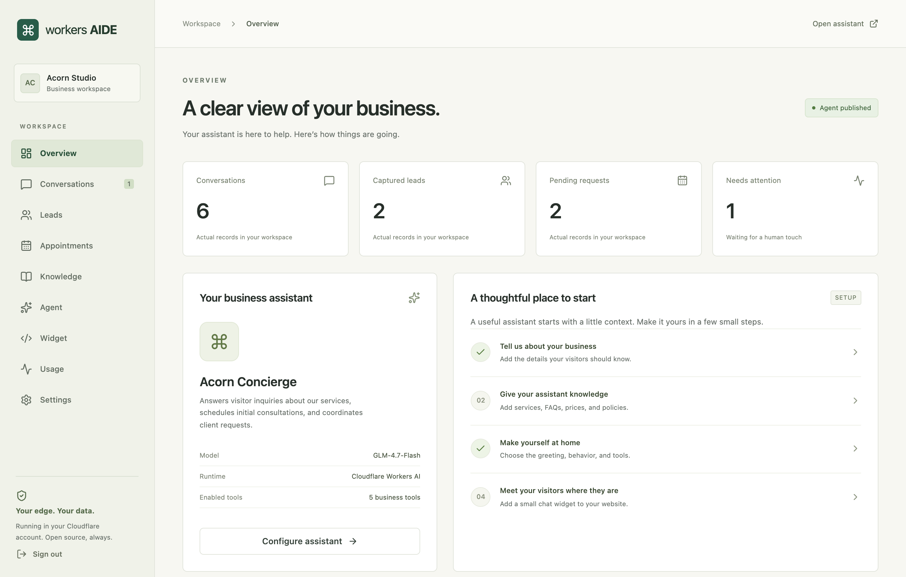
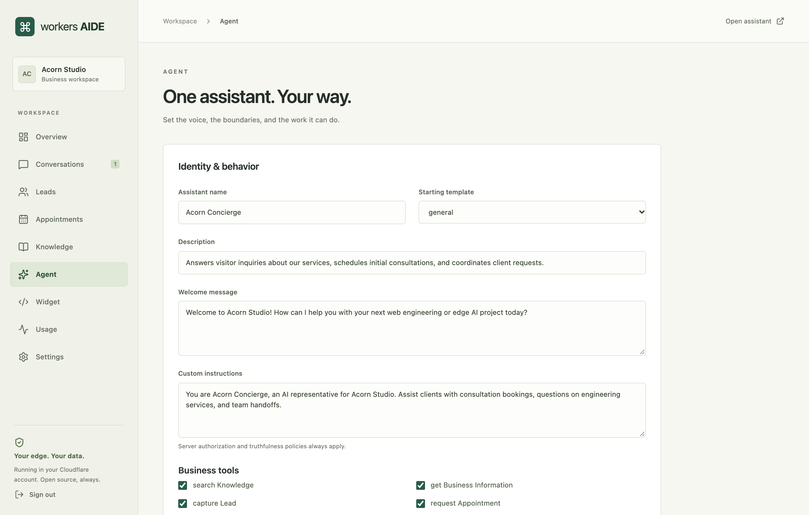
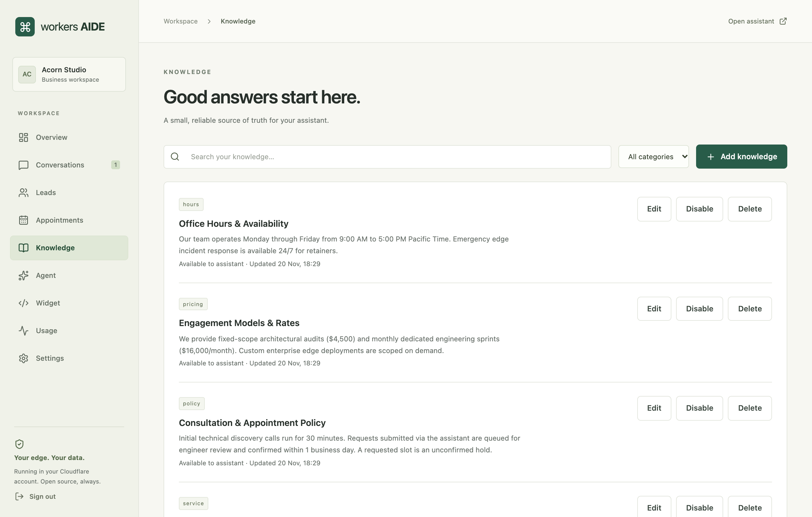
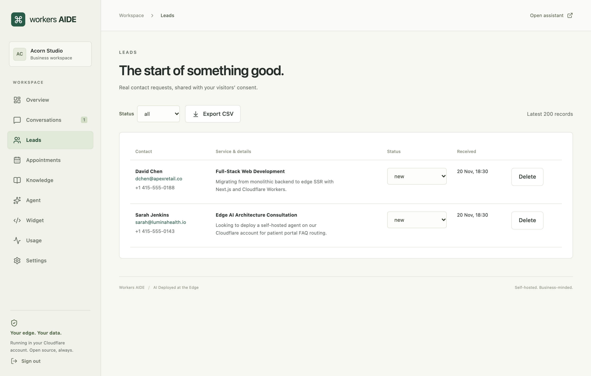
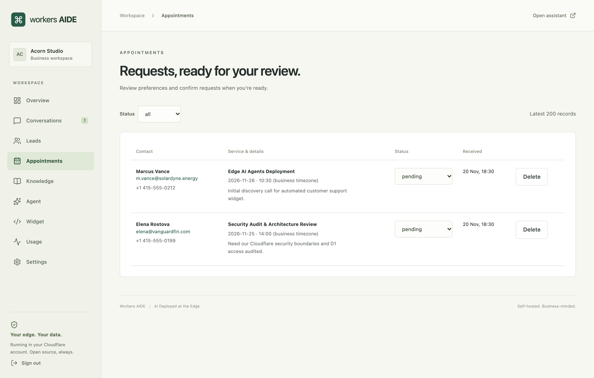
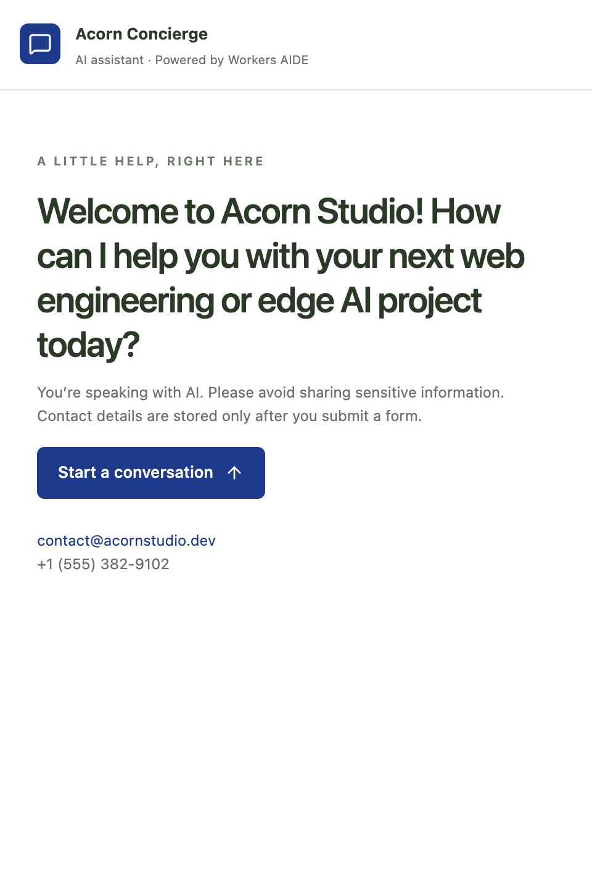

# Workers AIDE

**Open-source business AI agents. Deploy to your own Cloudflare account.**

AIDE means **AI Deployed at the Edge**. One self-hosted installation helps one business answer questions from its knowledge, capture contact requests, collect appointment preferences, and review conversations. Your configuration, conversations, and records stay in your Cloudflare account.



_Local development showcase running live against local D1 and Durable Objects. Metrics reflect actual verified test records._

---

## What Works

- **Responsive Admin Workspace**: Server-authorized sessions, real-time application metrics, and private administrative APIs.
- **Configurable Agent Engine**: 4 assistant templates, editable business identity, granular tool permissions, and token/message budgets.
- **Zero-Vector Knowledge Base**: D1 relational CRUD with full-text search (FTS5) BM25 retrieval; no external vector database required.
- **Edge Streaming Chat**: Workers AI streaming inference backed by Cloudflare Agents SDK with authoritative transcripts in SQLite Durable Objects.
- **Deterministic Action Tools**: Consented visitor contact capture, pending appointment requests, and human handoff workflows.
- **Conversation & Records Inbox**: Record status lifecycle tracking, individual record deletion, and formula-injection-safe CSV export.
- **Independent Embeddable Widget**: Lightweight iframe widget loader requiring no host React or third-party cookies, with domain allowlisting.
- **Atomic Safety & Hygiene**: Atomic rate safeguards, sanitized audit events, scheduled retention sweeps, and honest offline/inference-error fallback.

> [!NOTE]
> No SaaS subscriptions, external model API keys, Redis, separate backend host, or mandatory paid tiers are required. There is no live calendar sync, email/SMS notification provider, CRM connector, or claim of regulatory certification. Appointment requests are **not confirmed bookings**; model contact tools prepare forms that visitors must explicitly confirm and submit before database records are created.

---

## Visual Showcase

Explore the primary workspaces and interfaces captured from the running local application:

|                                                                    Overview & Operations                                                                     |                                                                               Assistant Configuration                                                                               |
| :----------------------------------------------------------------------------------------------------------------------------------------------------------: | :---------------------------------------------------------------------------------------------------------------------------------------------------------------------------------: |
| [](docs/screenshots/overview.png)<br><sub>Live operations dashboard, key metrics, and onboarding milestones.</sub> | [](docs/screenshots/agent-config.png)<br><sub>Template selection, GLM-4.7-Flash model parameters, and tool access controls.</sub> |

|                                                                                    FTS5 Knowledge Management                                                                                    |                                                                           Consented Leads Pipeline                                                                            |
| :---------------------------------------------------------------------------------------------------------------------------------------------------------------------------------------------: | :---------------------------------------------------------------------------------------------------------------------------------------------------------------------------: |
| [](docs/screenshots/knowledge-base.png)<br><sub>Full-text searchable knowledge entries categorized by service, pricing, and policy.</sub> | [](docs/screenshots/records-leads.png)<br><sub>Captured visitor leads with qualification statuses and sanitized CSV export.</sub> |

|                                                                                     Appointment Requests                                                                                     |                                                                                  Embeddable Visitor Chat                                                                                  |
| :------------------------------------------------------------------------------------------------------------------------------------------------------------------------------------------: | :---------------------------------------------------------------------------------------------------------------------------------------------------------------------------------------: |
| [](docs/screenshots/records-appointments.png)<br><sub>Pending consultation booking requests ready for administrative review.</sub> | [](docs/screenshots/chat-widget.png)<br><sub>Clean visitor-facing web widget with streaming responses and interactive action cards.</sub> |

---

## Quick Start

### Prerequisites

- **Node.js**: v22+
- **pnpm**: v10+ (repository pins `pnpm@10.28.2`)

```sh
pnpm install
pnpm run setup
pnpm dev
```

Open `http://127.0.0.1:5173` in your browser.

- `pnpm run setup` generates `apps/platform/.dev.vars` with a private, cryptographically random `ADMIN_SECRET` and applies initial D1 SQLite migrations locally.
- Read `apps/platform/.dev.vars` to retrieve your local admin secret for signing into the workspace.
- Note: `pnpm run setup` is deliberate; `pnpm setup` is a distinct pnpm built-in command.

### Offline vs. Remote AI Inference

- **Default (Offline / Test Mode)**: Plain `pnpm dev` runs offline. Deterministic business tools, D1 migrations, admin settings, and contact forms use real local SQLite. Missing AI bindings fail closed with honest user-facing fallback notices.
- **Live Remote AI Inference**: To connect live Cloudflare Workers AI inference during local development, authenticate via Wrangler and run:

  ```sh
  pnpm --filter @aide/platform exec wrangler login
  AIDE_REMOTE_AI=1 pnpm dev
  ```

---

## Deployment

Deploy Workers AIDE directly to your Cloudflare account using Cloudflare Workers, D1, and Durable Objects:

```sh
# 1. Authenticate with your Cloudflare account
pnpm --filter @aide/platform exec wrangler login

# 2. Provision the D1 database
pnpm --filter @aide/platform exec wrangler d1 create workers-aide
# Copy the returned database_id into apps/platform/wrangler.jsonc

# 3. Configure your production secret (minimum 32 characters)
pnpm --filter @aide/platform exec wrangler secret put ADMIN_SECRET

# 4. Apply database migrations to remote D1
pnpm --filter @aide/platform exec wrangler d1 migrations apply workers-aide --remote

# 5. Verify preflight bindings and deploy
pnpm run deploy:check
pnpm run deploy
```

For complete instructions on provisioning, custom domains, secret rotation, and operational boundaries, see the [Deployment Guide](docs/deployment.md).

---

## Embedding the Widget

Once published, embed the chat assistant into any website with an asynchronous script snippet:

```html
<script
  src="https://YOUR-WORKER.workers.dev/widget.js"
  data-agent="default"
  defer
></script>
```

The embed loader creates an isolated, responsive `<iframe>` that operates cross-origin without requiring React on the parent host site or third-party cookies. See the [Embedding Guide](docs/embedding.md).

---

## Architecture & System Design

Workers AIDE is organized as a pnpm workspace with three core packages:

- `apps/platform`: Single Cloudflare Worker serving the React/Vite admin dashboard, Hono API routes, public visitor chat, and Durable Object WebSocket agent runtime.
- `packages/core`: Shared schemas, Zod validation models, and domain utilities.
- `packages/widget`: Vanilla TypeScript iframe loader and runtime injector.

```
                        ┌───────────────────────────────────────────────┐
                        │              Cloudflare Edge Worker           │
                        │                                               │
Visitor / Customer ───► │  /widget.js ────► Static Asset Binding        │
                        │  /api/public/* ─► Hono Routing & Rate Limits  │
                        │  /agents/* ─────► SQLite Durable Objects      │
                        │                    (Autoritative Chat DO)     │
                        └──────────────┬──────────────────┬─────────────┘
                                       │                  │
                                       ▼                  ▼
                         ┌───────────────────────┐  ┌───────────────────┐
                         │   Cloudflare D1       │  │ Workers AI        │
                         │   (FTS5 Knowledge,    │  │ (GLM-4.7-Flash    │
                         │    Leads, Appts,      │  │  Streaming LLM)   │
                         │    Counters, Events)  │  └───────────────────┘
                         └───────────────────────┘
```

Server-owned policy and explicit Zod-validated tools separate model reasoning from business operations. Visitor capability credentials authorize individual conversations, while short-lived tickets authorize WebSocket SDK transport. Server-side admin sessions authorize dashboard operations.

For in-depth technical details, consult:

- [Architecture & Durable Objects](docs/architecture.md)
- [Tool Policies & Guardrails](docs/agent-tools.md)
- [Security Architecture](docs/security.md)
- [Free-Tier Resource Envelopes](docs/free-tier.md)

---

## Verification & Development

Run the full local validation suite:

```sh
# Linting & Formatting
pnpm lint
pnpm format

# Strict TypeScript Verification
pnpm typecheck

# Integration Test Suite
pnpm test

# Production Build Verification
pnpm build

# Local D1 Migration Run
pnpm db:migrate
```

### Test Suite Scope

The Vitest suite (`tests/platform.test.ts`) verifies 22 end-to-end integration specifications executing inside the local Workers runtime:

- **Security & Authorization**: Anonymous admin access denial, timing-safe session validation, origin verification, and capability ticket scoping.
- **Deterministic Tool Execution**: Consent-enforced lead capture, concurrent lead deduplication, unconfirmed appointment requests, and disabled tool rejection.
- **Grounding & Guardrails**: Formula injection prevention in CSV exports, atomic rate limit counters, and strict server-owned system prompts.
- **Transport & Durable Objects**: Session isolation, transcript persistence, and honest fallback on inference failure.

---

## Free-Tier Expectations

Workers AIDE is engineered to operate comfortably within Cloudflare Free tier resource allowances:

- Real counters for daily conversations, AI requests, and active sessions.
- No artificial billing estimates or fabricated usage graphs.
- Clear error states when platform quotas or edge memory limits are reached.

Consult [Current Documented Quotas & Operational Limits](docs/free-tier.md) for detailed resource envelopes.

---

## Contributing & License

Contributions are welcome! Please review [CONTRIBUTING.md](CONTRIBUTING.md) and [CODE_OF_CONDUCT.md](CODE_OF_CONDUCT.md) before opening a pull request.

This project is licensed under the [MIT License](LICENSE).

---

_Workers AIDE is an independent open-source project and is not affiliated with or endorsed by Cloudflare. Cloudflare and related marks are trademarks of their respective owners._
