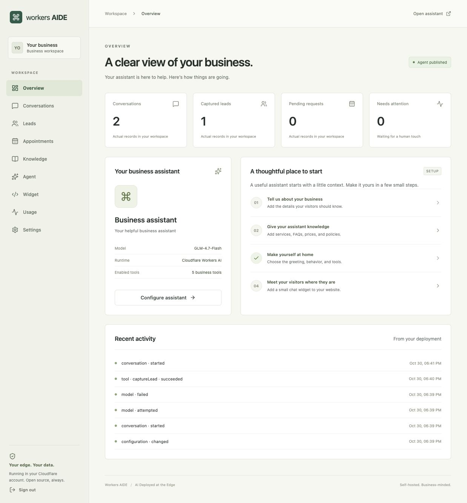

# Workers AIDE

**Open-source business AI agents. Deploy to your own Cloudflare account.**

AIDE means **AI Deployed at the Edge**. One self-hosted installation helps one business answer questions from its knowledge, capture contact requests, collect appointment preferences, and review conversations. Your configuration, conversations, and records stay in your Cloudflare account.

## What works

- Responsive admin workspace with server-authorized sessions and private APIs.
- Editable business profile, four assistant templates, tool permissions and usage budgets.
- D1 knowledge CRUD with indexed FTS5 retrieval; no vector database required.
- Workers AI streaming chat with one SQLite Durable Object per conversation.
- Contact capture with visitor form consent, pending appointment requests and human handoff.
- Conversation inbox, record statuses, deletion and safely escaped lead CSV export.
- Independent iframe widget, appearance settings and optional embedding allowlist.
- Atomic usage safeguards, sanitized events, scheduled retention and inference-error feedback.

No SaaS subscriptions, external model keys, Redis, separate backend host, or mandatory paid service. There is no live calendar, email/SMS notification, CRM connector, or claim of regulatory certification. Appointment requests are **not confirmed bookings**. Model contact tools prepare a form; the visitor submits it before any contact record is created.



_Local development screenshot. Counts reflect actual browser test records._

## Quick start

Node 22+ and pnpm are required. The repository pins pnpm 10.28.2.

```sh
pnpm install
pnpm run setup
pnpm dev
```

Open the local URL printed by Vite. The setup script creates `apps/platform/.dev.vars` with a random local admin secret and applies local D1 migrations. Read that ignored file privately to sign in. `pnpm run setup` is deliberate: `pnpm setup` is a different pnpm built-in command.

Configure your business, add real knowledge, then publish the assistant. The production defaults are unpublished and contain no fictional business data. Optional fictional examples are clearly marked in `examples/sample-knowledge.json`.

AI inference always runs remotely through Workers AI. Authenticate with `pnpm --filter @aide/platform exec wrangler login` for live inference, then run `AIDE_REMOTE_AI=1 pnpm dev`. Plain `pnpm dev` is offline and does not connect remote bindings. Without AI access, failures are reported honestly and local contact/appointment forms still use real D1. Ordinary tests do not require production credentials.

## Deploy

```sh
pnpm --filter @aide/platform exec wrangler login
pnpm --filter @aide/platform exec wrangler d1 create workers-aide
# Copy the returned database_id into apps/platform/wrangler.jsonc.
pnpm --filter @aide/platform exec wrangler secret put ADMIN_SECRET
pnpm --filter @aide/platform exec wrangler d1 migrations apply workers-aide --remote
pnpm run deploy:check
pnpm run deploy
```

Use a high-entropy secret of at least 32 characters. [Deployment instructions](docs/deployment.md) explain provisioning, validation, first publication, rotation, domains, and operations. Deployment is not performed automatically by setup or CI.

## Embed

After publishing, copy the snippet from Widget:

```html
<script
  src="https://YOUR-WORKER.workers.dev/widget.js"
  data-agent="default"
  defer
></script>
```

The loader does not require React on the host site or third-party cookies. [Embedding guide](docs/embedding.md).

## Architecture

A pnpm workspace with `apps/platform` (React/Vite, Hono, agent runtime), `packages/core` (shared domain exports), and `packages/widget` (independent loader). One Worker serves static assets, APIs, public chat and the widget. D1 stores business data and indexes; Agents SDK `AIChatAgent` manages authoritative transcripts in SQLite Durable Objects. `@cloudflare/ai-chat`, the AI SDK and Workers AI provide bounded streaming inference using GLM-4.7-Flash.

Server-owned policy and explicit Zod-validated tools separate model reasoning from business operations. Visitor capability credentials authorize one conversation; short-lived tickets authorize SDK transport. Server-side admin sessions authorize dashboard operations. [Architecture](docs/architecture.md) · [Tool policies](docs/agent-tools.md) · [Security](docs/security.md).

## Free-tier expectations

The implementation uses Free-compatible services and modest application safeguards. It does not guarantee a number of conversations or immunity from quota exhaustion. Actual token/Neuron usage and CPU must be checked in the Cloudflare dashboard. The Usage page shows application counters, never invented billing estimates. AI failures do not silently switch providers or claim writes succeeded. [Current documented quotas and operational limits](docs/free-tier.md).

## Development

```sh
pnpm format
pnpm lint
pnpm typecheck
pnpm test
pnpm build
pnpm db:migrate
pnpm --filter @aide/platform types
```

Workers integration tests exercise real local migrations, D1 CRUD, session protection, isolation, tool permissions, consent, idempotency, and limits. Live model behavior, remote deployment, actual quota behavior, and production CPU require authenticated verification; CI does not pretend to test them. [Development](docs/development.md) · [Configuration](docs/configuration.md).

## Roadmap

Prioritize real deployment/model evaluations and operational hardening, then optional calendar/CRM adapters and semantic retrieval where a business actually needs them. Multi-tenant billing, visual workflows, voice and arbitrary third-party code are outside v1.

## Contributing & license

See [Contributing](CONTRIBUTING.md) and the [Code of Conduct](CODE_OF_CONDUCT.md). This project is [MIT License](LICENSE)d.

Workers AIDE is an independent project, not affiliated with or endorsed by Cloudflare. Cloudflare and other product names belong to their respective owners. The working project name is not represented as trademark-cleared.
